Databricks, Airflow3.0, Buckets tutorial
Made from video: https://www.youtube.com/watch?v=92X54U6gm0Y&t=4268s

Code contains data bricks notebooks, databricks jobs, databricks dashboard.
Basics of airflow, such as connection to aws-like bucket, running airflow in Kubernetes and downloading data from web and running a data bricks notebook from airflow.
Also included is publishing docker image of the airflow code on ghcr in this repo.

Databricks Workflow

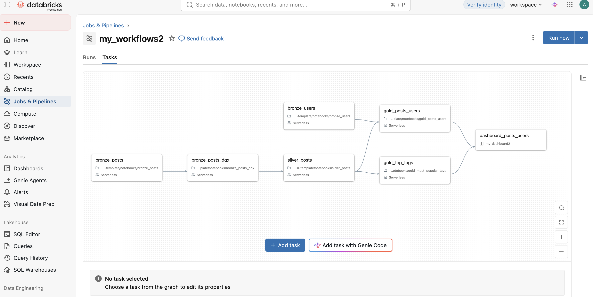

Databricks Workflow Runs

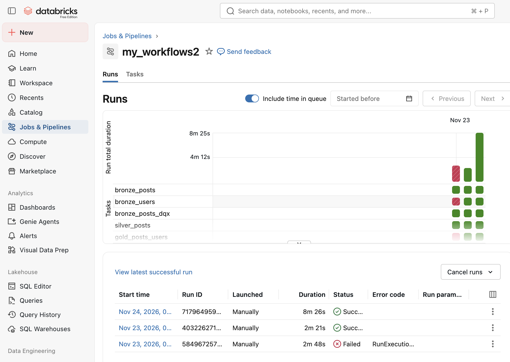

Databricks Catalog

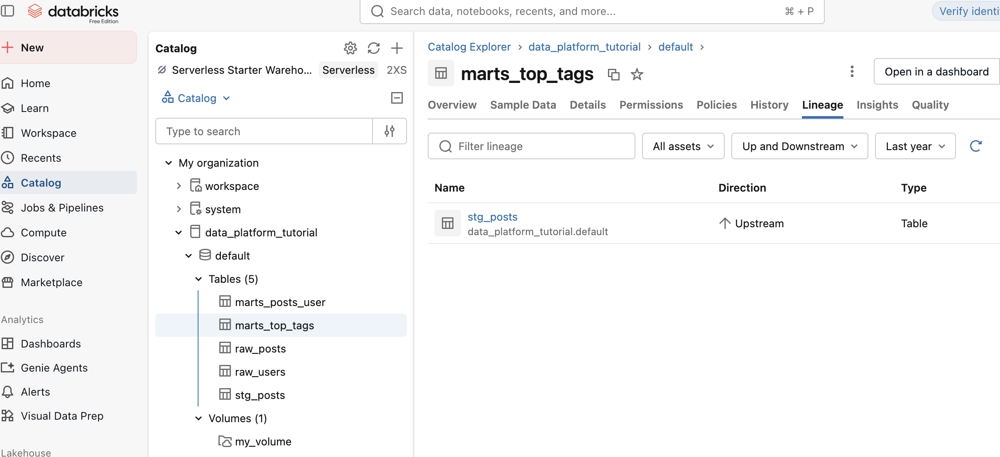

Databricks Dashboard

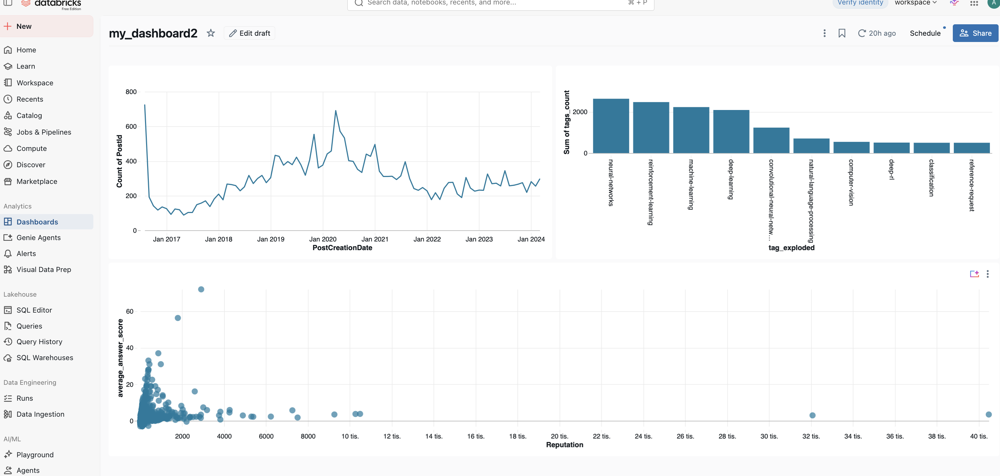

Bronze Notebook

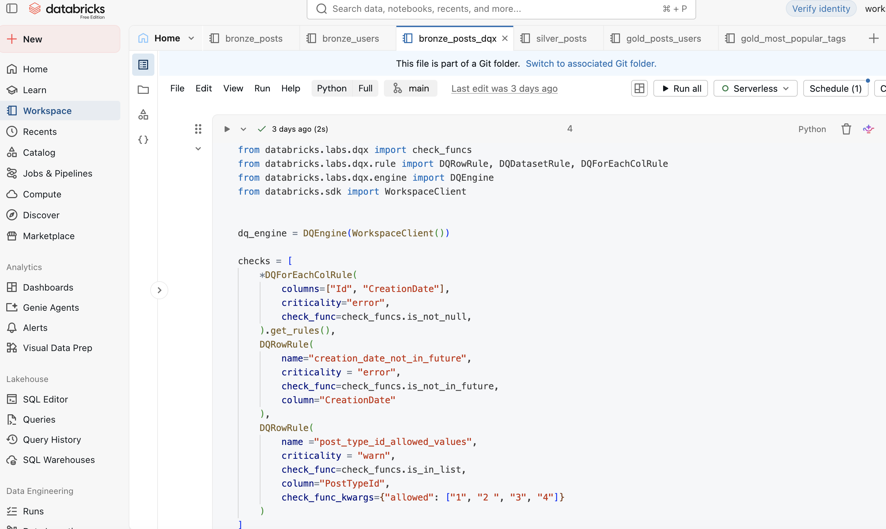

Silver Notebook

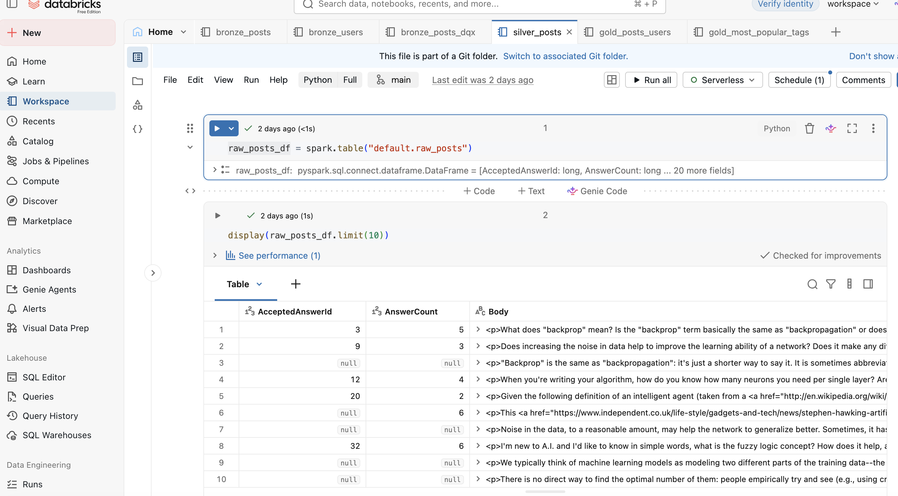

Gold Notebook

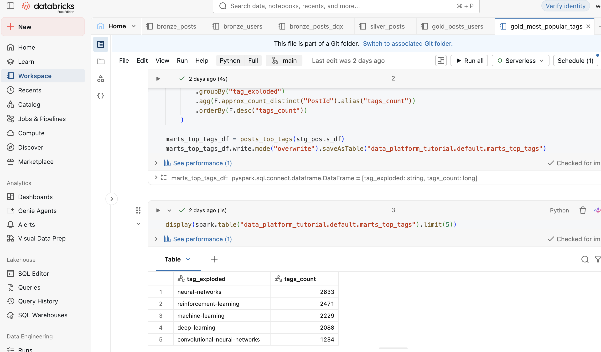

Airflow

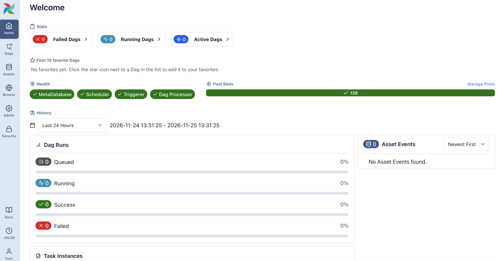

Airflow DAGs

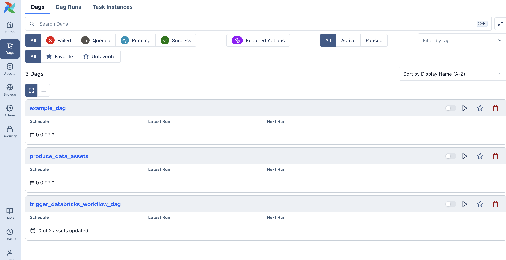

Airflow Assets Graph

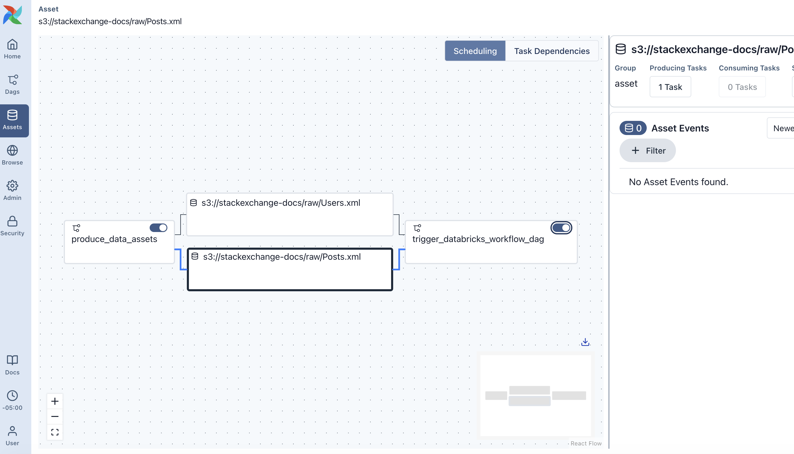

Airflow DAG Run

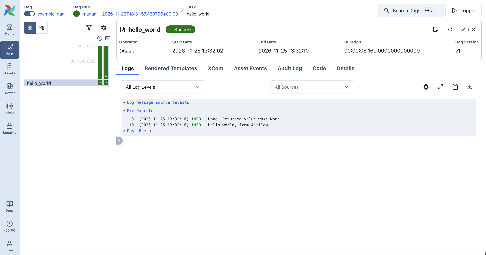

Airflow DAG Run

VS Code Airflow Source Code

Installation Script

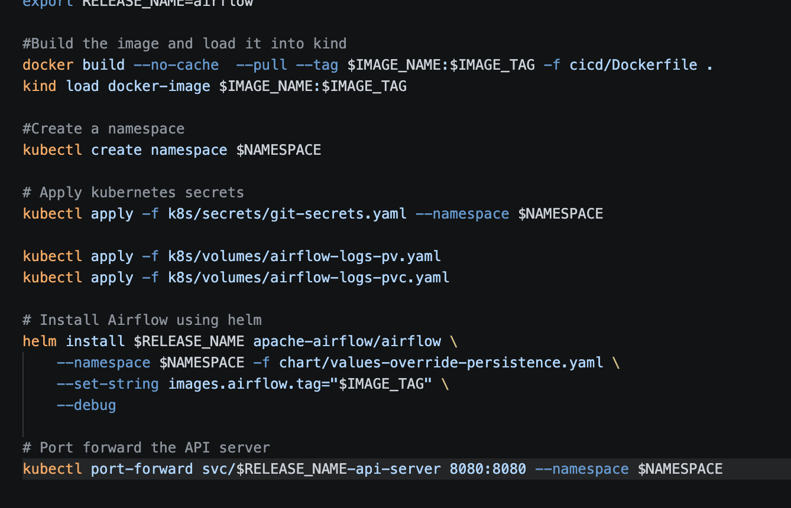

Installation Script

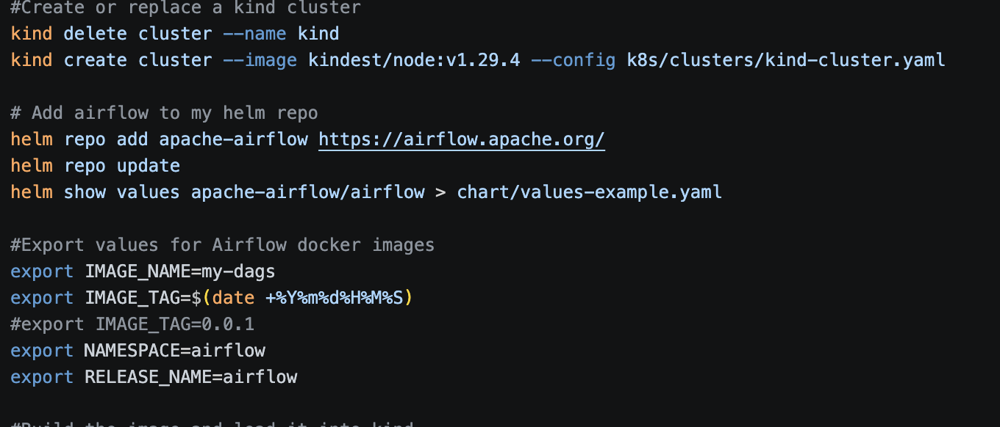

Airflow Pods on Kubernetes

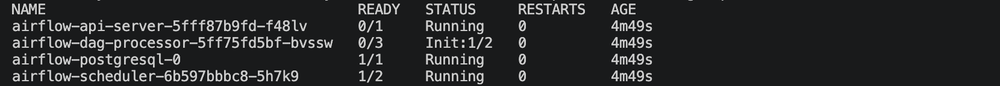

Airflow Port Forwarding on Kubernetes

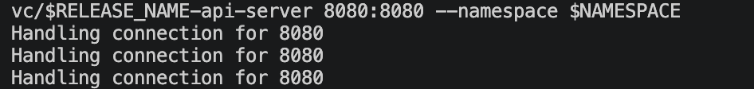

GHCR CI/CD

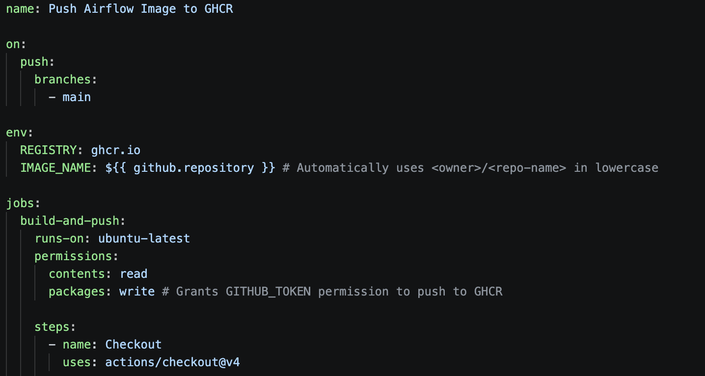
